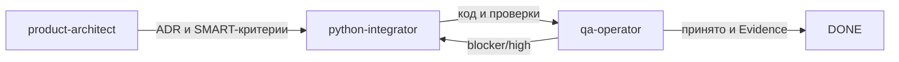

# Агентный процесс



## Роли

- `product-architect` отвечает за пользовательские границы, Sheets-схему, формулы,
  ADR и SMART-декомпозицию.
- `python-integrator` реализует один вертикальный срез Python/aiogram/OpenAI/Gemini/Sheets.
- `qa-operator` независимо проверяет дубли, timeout, timezone, формулы, secrets,
  Docker и воспроизводимость инструкции.

## Передача задачи

```text
Task: FT-xxx
Outcome: один наблюдаемый результат
Allowed files: точные пути
Acceptance: измеримые проверки из TASKS.md
Out of scope: явные ограничения
Timebox: оценка из TASKS.md
Handoff: changes, checks, risks, next task
```

Один файл имеет одного владельца. Live Telegram/OpenAI/Gemini/Google Sheets не используются
без явного разрешения владельца. `qa-operator` проверяет изменение после реализации;
blocker/high закрываются до `DONE`.
