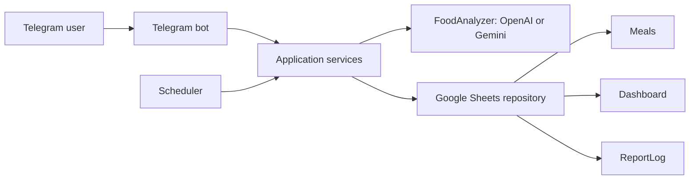
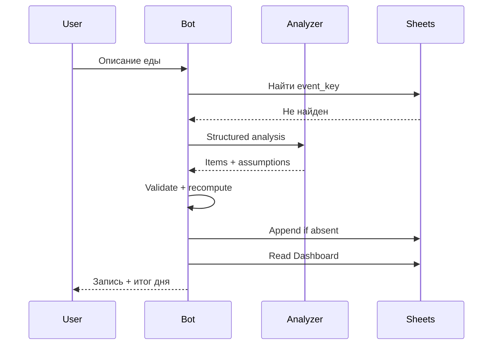

# Архитектура Telegram Food Tracker

## Цель и границы

Это личный бот для одного владельца. Пользователь описывает еду обычным текстом, бот
сохраняет приблизительные КБЖУ в Google Sheets, показывает историю и после 21:00
отправляет итог дня. Фото, несколько пользователей, медицинские выводы, персональные
нормы и продуктовый справочник не входят в MVP.

## Система

Один Go-процесс использует Telegram long polling. Domain/application не знают
о Telegram SDK, HTTP-библиотеках и Google SDK. Все внешние зависимости реализуют интерфейсы и имеют
fake для тестов.

## Основные контракты

### `FoodAnalyzer`

- `analyze(text) -> MealAnalysis`;
- `analyze_correction(text, meal) -> MealCorrection`.

Выбранный провайдер (OpenAI или Gemini) возвращает позиции, массу, kcal, белки, жиры, углеводы, пищевые группы,
допущения, confidence и, при необходимости, уточняющий вопрос. Доменная модель строго проверяет
JSON. Приложение игнорирует внешний итог и суммирует проверенные позиции само.

### `SheetsRepository`

- найти событие по `event_key`;
- добавить приём пищи, только если ключ отсутствует;
- прочитать Dashboard, сегодняшние и последние записи;
- найти/обновить приём по стабильному `meal_id`;
- атомарно для одного процесса заявить дневной отчёт;
- завершить отчёт или очистить личные данные.

Все операции с Google Sheets API сериализуются одним `sync.Mutex` (check/append и find/update).

## Google Sheets

### `Meals`

| Column | Meaning |
|---|---|
| `event_key` | `chat_id:message_id`, ключ исходного Telegram-сообщения |
| `meal_id` | UUID, не зависит от положения строки |
| `logged_at` | RFC 3339 timestamp с offset |
| `local_date` | `YYYY-MM-DD` в `APP_TIMEZONE` |
| `raw_text` | исходное сообщение владельца |
| `summary` | краткое нормализованное описание |
| `kcal`, `protein_g`, `fat_g`, `carbs_g` | пересчитанный итог |
| `items_json` | проверенные позиции со стабильными item ID |
| `assumptions` | допущения через JSON |
| `revision` | версия строки, начинается с 1 |
| `last_edit_event_key` | защита от повторной корректировки |

### `Dashboard`

Ячейка с текущей датой и четыре формулы `SUMIF` по ограниченному диапазону
`Meals!2:10000`. Формулы считают КБЖУ за `local_date`. Setup
устанавливает timezone таблицы равной `APP_TIMEZONE`.

### `ReportLog`

`report_key`, `local_date`, `status`, `sent_at`, `telegram_message_id`. Ключ имеет
вид `daily:<telegram_user_id>:<local_date>`.

## Поток добавления еды

Одновременные повторы разделяют одну inflight-задачу. При timeout append результат
считается неизвестным: repository сначала повторно ищет `event_key` и не выполняет
слепой append. Если процесс упал после записи, повторный Telegram update найдёт строку
и вернёт сохранённый результат.

## Валидация и уточнения

- значения конечны и неотрицательны;
- не более 20 позиций;
- масса одной позиции не выше 5 000 г;
- значения одной позиции и итог не выше 10 000 kcal;
- до 5 000 kcal итог принимается автоматически;
- 5 001–10 000 kcal требует причины модели и подтверждения владельца;
- более 10 000 kcal отклоняется;
- неуверенный анализ задаёт один уточняющий вопрос в 15-минутной сессии.

## Корректировка

`/edit_last` открывает 15-минутную сессию для последнего `meal_id`. Модель сопоставляет
текст исправления с одним существующим `item_id` и возвращает новый вес. Приложение
проверяет принадлежность item, масштабирует его КБЖУ относительно старой массы,
пересчитывает весь приём, увеличивает `revision` и записывает `last_edit_event_key`.
Добавление, удаление и замена продуктов не входят в MVP.

## Отчёт и рекомендации

Scheduler раз в минуту проверяет локальное время. После 21:00 он создаёт в ReportLog
запись `sending`, отправляет отчёт и меняет статус на `sent`. Наличие ключа предотвращает
повтор. В день без еды отчёт не отправляется.

Рекомендации детерминированы: бот отмечает неполный дневник, отсутствие распознанных
овощей/фруктов или явного источника белка. Он не сравнивает результат с персональной
нормой и не делает медицинских выводов.

## Безопасность и эксплуатация

- allowlist применяется до OpenAI и Sheets;
- `AI_PROVIDER` выбирает ровно один адаптер: OpenAI Responses (`store=false`) или Gemini
  Interactions; запрос не отправляется второму провайдеру как fallback;
- secrets поступают только из environment/read-only mount;
- в логах нет токенов, credentials, сырого ответа модели и полного профиля Telegram;
- один контейнер и одна реплика — обязательное ограничение;
- live-вызовы запрещены в стандартных тестах;
- `/delete_me` требует callback-подтверждение и очищает Meals/ReportLog.

Основной осознанный компромисс: Google Sheets не даёт транзакции вместе с Telegram.
ReportLog выбирает at-most-once поведение: редкий crash между claim и send может
пропустить отчёт, зато не создаст дубль.
